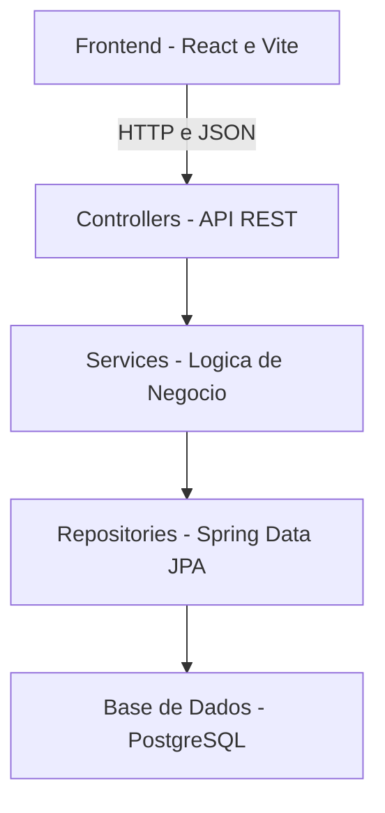

# StudyMatch — Arquitetura de Software e Justificação da Stack

## 1. Introdução

O StudyMatch é uma aplicação full-stack destinada a apoiar a formação automática de grupos de estudantes universitários, utilizando informações do percurso académico, competências e características de colaboração de cada estudante.

O objetivo é permitir a formação de grupos mais equilibrados e adequados aos diferentes contextos académicos, considerando não apenas o desempenho individual, mas também critérios pedagógicos e operacionais.

O projeto contempla duas funcionalidades criativas propostas pela equipa:

- **Cold Start através de dilemas situacionais (UC04):** permite construir um perfil operacional provisório para estudantes que ainda não possuem histórico académico suficiente. O estudante responde a cenários relacionados com trabalho em equipa, permitindo identificar tendências de colaboração.
- **Compatibilidade operacional e ritmo de trabalho (UC05):** permite recolher a disponibilidade semanal e as preferências de ritmo de trabalho dos estudantes, procurando reduzir incompatibilidades na futura formação dos grupos.

Este documento apresenta as tecnologias selecionadas, a arquitetura inicial da aplicação, a responsabilidade dos principais componentes e a estratégia de integração técnica prevista para o Sprint 1.

A arquitetura foi concebida para facilitar a manutenção, a testabilidade, a modularidade e a evolução do sistema ao longo dos próximos Sprints.

## 2. Tecnologias Selecionadas

Para o desenvolvimento do StudyMatch, a equipa definiu a seguinte stack tecnológica:

| Camada | Tecnologia | Responsabilidade |
|---|---|---|
| Frontend | React + Vite | Interface do utilizador |
| Backend | Java + Spring Boot | API REST e lógica de negócio |
| Persistência | PostgreSQL | Armazenamento persistente dos dados |
| Build Backend | Maven | Compilação e gestão de dependências |
| Build Frontend | Vite + npm | Desenvolvimento, dependências e compilação do frontend |
| Versionamento | Git + GitHub | Controlo de versões e colaboração |

### 2.1. Frontend — React e Vite

O React foi selecionado para o desenvolvimento da interface web do StudyMatch.

Esta biblioteca JavaScript permite criar interfaces baseadas em componentes reutilizáveis, facilitando a organização e a manutenção do código.

**Justificação da escolha:**

- Permite desenvolver interfaces modulares e reutilizáveis.
- Facilita a manutenção e evolução da aplicação.
- Integra-se facilmente com APIs REST.
- Possui documentação extensa e uma comunidade ativa.
- Permite realizar testes aos componentes da interface.
- Favorece a separação entre apresentação e lógica de negócio.

O Vite será utilizado como ferramenta de desenvolvimento e build do frontend.

**Vantagens do Vite:**

- Inicialização rápida do ambiente de desenvolvimento.
- Atualização eficiente da interface durante o desenvolvimento.
- Configuração inicial simples.
- Integração direta com React.

O frontend será responsável por apresentar os dados aos utilizadores e comunicar com o backend através de pedidos HTTP.

### 2.2. Backend — Java e Spring Boot

O backend será desenvolvido em Java, utilizando o framework Spring Boot.

O Spring Boot permite implementar APIs REST e organizar a aplicação em componentes com responsabilidades bem definidas.

**Justificação da escolha:**

- Facilita o desenvolvimento de serviços REST.
- Suporta a organização da aplicação em camadas.
- Disponibiliza mecanismos de injeção de dependências.
- Integra-se com sistemas de bases de dados relacionais.
- Oferece ferramentas para testes automatizados.
- Promove a separação de responsabilidades.
- Permite acrescentar novas funcionalidades de forma modular.

O backend será responsável por receber os pedidos do frontend, validar os dados e executar as regras de negócio.

Entre as funcionalidades previstas encontram-se:

- Gestão de estudantes e do percurso académico.
- Registo de inscrições e classificações.
- Cálculo e consulta de perfis de competências.
- Gestão dos contextos de agrupamento.
- Processamento de dilemas situacionais para Cold Start.
- Gestão da disponibilidade e dos ritmos de trabalho.
- Futura implementação da formação automática de grupos.

### 2.3. Persistência — PostgreSQL

O PostgreSQL foi selecionado como sistema de gestão de bases de dados relacional.

Será responsável pelo armazenamento persistente dos dados necessários ao funcionamento da aplicação.

**Justificação da escolha:**

- Suporta relações entre entidades e integridade referencial.
- Disponibiliza transações para garantir consistência dos dados.
- É uma solução open-source.
- Permite realizar consultas SQL estruturadas.
- Integra-se com Spring Boot.
- Suporta a evolução do modelo de dados.
- Possui ferramentas adequadas para desenvolvimento e testes.

A persistência poderá ser implementada através de Spring Data JPA, permitindo abstrair parte das operações de acesso aos dados.

O modelo de persistência deverá respeitar as entidades, os relacionamentos e as restrições definidos no modelo de domínio.

### 2.4. Build e Dependências — Maven

O Maven será utilizado para gerir as dependências e o processo de compilação do backend.

**Justificação da escolha:**

- Centraliza as dependências no ficheiro `pom.xml`.
- Permite automatizar a compilação.
- Facilita a execução de testes.
- Promove a consistência entre ambientes.
- Integra-se com Spring Boot.
- Simplifica a gestão das bibliotecas utilizadas.

No frontend, as dependências serão geridas através de npm e o processo de desenvolvimento e build será suportado pelo Vite.

### 2.5. Controlo de Versões — Git e GitHub

O Git será utilizado para gerir o histórico de alterações do projeto.

O GitHub será utilizado como plataforma de colaboração, organização de tarefas e revisão de código.

A equipa seguirá o fluxo:

Issue → Branch → Implementação → Pull Request → Review → Merge

Cada alteração deverá estar associada a uma Issue e ser desenvolvida numa branch própria.

O processo encontra-se documentado no ficheiro [WORKFLOW.md](../WORKFLOW.md).

## 3. Arquitetura de Software

O StudyMatch adotará inicialmente uma arquitetura em camadas.

Esta abordagem permite separar a interface do utilizador, a comunicação HTTP, a lógica de negócio e o acesso aos dados.

A separação de responsabilidades pretende reduzir o acoplamento entre componentes e facilitar futuras alterações.

### 3.1. Diagrama de Arquitetura



O diagrama representa a arquitetura lógica inicial da aplicação.

O frontend comunica com os controllers através de HTTP. Os controllers encaminham as operações para os services, que executam as regras de negócio. Sempre que é necessário aceder a dados persistentes, os services utilizam os repositories, responsáveis pela comunicação com o PostgreSQL.

As entidades e conceitos do domínio são utilizados principalmente pela lógica de negócio e pela camada de persistência, não constituindo uma camada de comunicação adicional.

### 3.2. Responsabilidades das Camadas

#### 3.2.1. Frontend — React

O frontend será responsável pela interação entre o utilizador e o sistema.

As suas principais responsabilidades serão:

- Apresentar informações académicas dos estudantes.
- Disponibilizar formulários e páginas.
- Apresentar perfis de competências.
- Disponibilizar interfaces para recolha de disponibilidade.
- Apresentar os dilemas situacionais do Cold Start.
- Enviar pedidos HTTP à API.
- Apresentar respostas e mensagens de erro.

O frontend não deverá comunicar diretamente com a base de dados.

#### 3.2.2. API REST — Controllers

Os controllers serão responsáveis por disponibilizar os endpoints da aplicação.

As suas principais responsabilidades serão:

- Receber pedidos HTTP.
- Interpretar os dados enviados pelo frontend.
- Realizar validações básicas de entrada.
- Encaminhar operações para os services.
- Devolver respostas HTTP em formato JSON.
- Comunicar situações de erro através de respostas adequadas.

A lógica de negócio principal não deverá estar implementada nos controllers.

#### 3.2.3. Services — Lógica de Negócio

A camada de serviços será responsável pela execução das regras funcionais do StudyMatch.

As principais responsabilidades previstas incluem:

**Gestão académica:**
- Validar e processar registos académicos.
- Gerir inscrições e tentativas de avaliação.
- Validar classificações.
- Determinar a progressão académica.

**Gestão de competências:**
- Identificar competências associadas a unidades curriculares.
- Aplicar os pesos de competência definidos.
- Calcular os níveis agregados de competências.
- Atualizar os perfis académicos dos estudantes.

**Contextos de agrupamento:**
- Validar dimensões mínimas e máximas dos grupos.
- Gerir critérios pedagógicos de agrupamento.
- Associar os contextos às unidades curriculares.
- Preparar os dados necessários à futura formação de grupos.

**Cold Start:**
- Processar as respostas aos dilemas situacionais.
- Identificar características operacionais provisórias.
- Gerar perfis provisórios.
- Associar níveis de confiança aos perfis.
- Permitir a evolução dos perfis com a acumulação de evidências académicas.

**Compatibilidade operacional:**
- Validar blocos de disponibilidade semanal.
- Gerir preferências de ritmo de trabalho.
- Aplicar a regra de disponibilidade mínima definida nos casos de uso.
- Disponibilizar informações operacionais para a futura formação de grupos.

A implementação do algoritmo definitivo de agrupamento será desenvolvida e ajustada em Sprints posteriores.

#### 3.2.4. Repositories — Persistência

Os repositories serão responsáveis pelo acesso aos dados persistentes.

As principais responsabilidades incluem:

- Consultar registos existentes.
- Inserir novos registos.
- Atualizar informações.
- Eliminar registos quando permitido.
- Executar operações de pesquisa.
- Abstrair detalhes de comunicação com a base de dados.

A utilização de Spring Data JPA é proposta para implementar esta camada.

#### 3.2.5. Base de Dados — PostgreSQL

O PostgreSQL será responsável por armazenar os dados da aplicação.

O sistema deverá preservar a integridade e a consistência dos registos académicos, competências, perfis e contextos de agrupamento.

A estrutura relacional será definida com base no modelo de domínio conceptual e ajustada durante a implementação.

## 4. Modelo de Domínio

A arquitetura deverá suportar as entidades e conceitos definidos no documento [DOMAIN_MODEL.md](DOMAIN_MODEL.md).

O modelo encontra-se organizado nos seguintes grupos.

### 4.1. Núcleo Académico

- **Student:** representa o estudante.
- **DegreeCourse:** representa o curso.
- **CourseUnit:** representa uma unidade curricular.
- **Enrollment:** representa a inscrição numa unidade curricular.
- **AcademicAttempt:** representa uma tentativa de avaliação e a respetiva classificação.

### 4.2. Competências e Perfil

- **Competency:** representa uma competência.
- **CompetencyWeight:** representa o peso de contribuição de uma unidade curricular para determinada competência.
- **StudentCompetencyProfile:** representa a informação agregada das competências do estudante.

### 4.3. Contexto de Agrupamento

- **GroupingContext:** representa o contexto académico em que serão formados os grupos.
- **GroupingCriteria:** representa os critérios pedagógicos definidos para esse contexto.

### 4.4. Cold Start

- **ScenarioDilemma:** representa um dilema situacional.
- **DilemmaOption:** representa uma opção de resposta associada a um dilema.
- **ProvisionalProfile:** representa o perfil operacional provisório de um estudante sem histórico académico suficiente.

### 4.5. Compatibilidade Operacional

- **TimeAvailabilitySlot:** representa um bloco de disponibilidade semanal.
- **WorkPacingProfile:** representa as preferências de ritmo de trabalho do estudante.

Estas entidades constituem conceitos de negócio. A sua representação em classes Java e tabelas relacionais será definida durante a implementação.

## 5. Regras de Negócio e Requisitos Funcionais

A arquitetura deverá permitir implementar as regras de negócio identificadas nos casos de uso existentes.

### 5.1. UC01 — Histórico e Percurso Académico

- As classificações devem estar compreendidas entre 0 e 20 valores.
- Uma classificação igual ou superior a 10 representa aprovação.
- O número de tentativas deve ser positivo.
- O sistema deve impedir registos académicos duplicados nas condições definidas.

### 5.2. UC02 — Perfil de Competências

- As competências são calculadas com base nas unidades curriculares concluídas.
- Cada unidade curricular poderá contribuir para diferentes competências.
- A contribuição de cada unidade curricular depende dos pesos definidos.
- Os níveis de competência deverão ser apresentados numa escala normalizada.

### 5.3. UC03 — Contexto de Agrupamento

- Os contextos devem estar associados a unidades curriculares.
- A dimensão mínima de um grupo não pode ser superior à máxima.
- O tamanho mínimo permitido é de dois estudantes.
- O contexto deverá permitir definir critérios pedagógicos.

### 5.4. UC04 — Cold Start

- O estudante responde a dilemas situacionais.
- As respostas são utilizadas para criar um perfil operacional provisório.
- Os dilemas obrigatórios devem ser respondidos antes do cálculo do perfil.
- O perfil provisório possui um nível de confiança inferior ao de um perfil fundamentado em evidências académicas.
- O perfil deverá evoluir progressivamente com a acumulação de histórico académico.

### 5.5. UC05 — Disponibilidade e Ritmo de Trabalho

- O estudante poderá indicar os seus períodos semanais de disponibilidade.
- A disponibilidade mínima declarada deverá corresponder a quatro horas úteis por semana.
- O estudante poderá indicar a sua preferência de ritmo de trabalho.
- A informação operacional poderá ser considerada no futuro algoritmo de agrupamento.

Estas regras pertencem à lógica de negócio e deverão ser implementadas principalmente na camada de services.

As especificações encontram-se no documento [USE_CASES.md](USE_CASES.md).

## 6. Comunicação entre Componentes

A comunicação entre o frontend e o backend será realizada através de HTTP, utilizando uma API REST.

Os dados serão enviados e recebidos preferencialmente em formato JSON.

O fluxo principal será:

1. O utilizador realiza uma ação na interface React.
2. O frontend envia um pedido HTTP à API Spring Boot.
3. O controller recebe e interpreta o pedido.
4. O service executa a operação e aplica as regras de negócio.
5. Caso seja necessário, o repository comunica com o PostgreSQL.
6. O backend devolve a resposta ao frontend.
7. O React apresenta os dados ou uma mensagem ao utilizador.

Esta separação permite desenvolver e testar as camadas com responsabilidades bem definidas.

## 7. Estrutura Inicial do Projeto

A estrutura proposta para o repositório é:

```text
studymatch-g01/
|
|-- frontend/
|   |-- src/
|   |   |-- components/
|   |   |-- pages/
|   |   |-- services/
|   |-- package.json
|
|-- backend/
|   |-- src/
|   |   |-- main/
|   |   |   |-- java/
|   |   |   |   |-- controller/
|   |   |   |   |-- service/
|   |   |   |   |-- repository/
|   |   |   |   |-- model/
|   |   |   |-- resources/
|   |   |-- test/
|   |-- pom.xml
|
|-- docs/
|   |-- DOMAIN_MODEL.md
|   |-- USE_CASES.md
|   |-- architecture.md
|
|-- README.md
|-- WORKFLOW.md
|-- .gitignore
```

Esta estrutura representa uma proposta de organização e não significa que todas as pastas já estejam implementadas.

A estrutura poderá evoluir com as necessidades identificadas nos próximos Sprints.

## 8. Integração Técnica — Sprint 1

Durante o Sprint 1, será desenvolvida uma funcionalidade mínima para validar a comunicação entre as tecnologias selecionadas.

O objetivo não é implementar todas as funcionalidades do StudyMatch, mas demonstrar uma operação completa entre frontend, backend e base de dados.

### 8.1. Cenário Proposto — Consulta de Estudantes

A equipa poderá implementar o seguinte cenário:

1. O frontend React apresenta uma página de consulta de estudantes.
2. O utilizador solicita a listagem de estudantes.
3. O React envia um pedido GET para um endpoint da API.
4. O backend Spring Boot recebe o pedido.
5. O service solicita os dados através do repository.
6. O repository consulta a base de dados PostgreSQL.
7. O backend devolve os estudantes em formato JSON.
8. O frontend apresenta os resultados no ecrã.

Um possível endpoint para esta funcionalidade será:

`GET /api/students`

Este endpoint é apenas uma proposta para a implementação do Sprint 1.

### 8.2. Objetivos da Integração

A implementação mínima deverá demonstrar que:

- O frontend inicia corretamente.
- O backend inicia corretamente.
- Existe comunicação HTTP entre frontend e backend.
- O backend consegue consultar ou armazenar dados no PostgreSQL.
- A operação é demonstrável através da interface.
- O projeto pode ser compilado com as ferramentas selecionadas.

## 9. Práticas de Qualidade de Software

A qualidade de software deverá ser considerada desde o início do desenvolvimento.

A arquitetura proposta procura seguir os seguintes princípios:

### 9.1. Separação de Responsabilidades

Cada componente deverá ter funções claramente definidas, evitando a concentração de lógica de negócio na interface ou nos controllers.

### 9.2. Modularidade

A aplicação deverá ser organizada em componentes independentes sempre que possível, facilitando a implementação de novas funcionalidades.

### 9.3. Manutenibilidade

A estrutura do projeto deverá permitir modificar e corrigir componentes sem exigir alterações extensas nas restantes camadas.

### 9.4. Testabilidade

A organização da aplicação deverá facilitar a criação de testes unitários e de integração.

Os services deverão permitir testar regras de negócio independentemente da interface.

### 9.5. Controlo de Versões e Revisão

O desenvolvimento seguirá as regras documentadas em `WORKFLOW.md`.

Cada tarefa deverá:

- Estar associada a uma Issue.
- Ser desenvolvida numa branch própria.
- Ser submetida através de Pull Request.
- Ser revista por outro elemento da equipa.
- Ser integrada na branch principal após aprovação.

As alterações relevantes deverão manter a documentação atualizada.

### 9.6. Definition of Done

A equipa seguirá os critérios estabelecidos no ficheiro `WORKFLOW.md`.

Uma tarefa apenas será considerada concluída após cumprir os critérios aplicáveis de implementação, documentação, rastreabilidade e revisão.

## 10. Evolução da Arquitetura

O StudyMatch será desenvolvido de forma incremental ao longo de vários Sprints.

Nesta fase, a prioridade consiste em estabelecer uma base técnica estável e organizada.

Os requisitos futuros poderão implicar alterações na estrutura da aplicação, no modelo de dados ou nos componentes existentes.

Por esse motivo, a arquitetura deverá privilegiar:

- Responsabilidades bem definidas.
- Baixo acoplamento entre componentes.
- Facilidade de extensão.
- Reutilização de código.
- Separação entre regras de negócio e detalhes técnicos.
- Capacidade de integração de novas funcionalidades.

O algoritmo definitivo de formação automática de grupos permanece em aberto e deverá ser definido e justificado de acordo com a evolução dos requisitos.

## 11. Conclusão

A arquitetura inicial proposta para o StudyMatch utiliza React e Vite no frontend, Java e Spring Boot no backend, PostgreSQL para persistência de dados e Maven para gestão do build do backend.

A arquitetura em camadas permite separar as responsabilidades da interface, API REST, lógica de negócio e persistência.

A proposta encontra-se alinhada com os casos de uso e com o modelo de domínio definidos pela equipa, incluindo as funcionalidades criativas de Cold Start e compatibilidade operacional.

Durante o Sprint 1, será implementado um esqueleto técnico funcional que demonstre a comunicação entre as principais tecnologias.

Esta arquitetura constitui uma base inicial para o desenvolvimento do StudyMatch, podendo ser ajustada em Sprints posteriores de acordo com novos requisitos.
